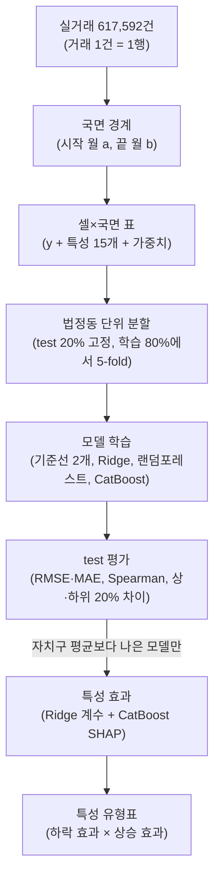

<div align="center">

# 🏙️ 시장 국면별 서울 아파트 특성 분석

**어떤 특성의 아파트가 하락기에 버티고, 상승기에 앞서는가**

2017–2026년 서울 아파트 매매 실거래 **617,592건**으로 시장 국면을 나누고,
국면마다 아파트(단지×면적)가 서울 평균보다 얼마나 더(덜) 움직였는지를 특성으로 설명한다.
그 결과로 특성을 **전천후형·방어형·공격형·취약형·국면 무관**으로 구분한다.


기계학습기초 4조

</div>

---

## 📘 보고서 작성 안내

1. [최종 연구 보고서](reports/final/README.md) — 국면표, 모델 성능, 특성 유형표, 결론과 한계
2. [연구 방법](docs/methodology.md) — 예시 셀 하나로 따라가는 입력 → 출력 흐름
3. [데이터 규격](docs/data.md) — 출처, 버전(v1→v5), 43개 열, 결측과 처리
4. [결정 기록](docs/decisions.md) · [국면 근거](docs/evidence/README.md)
5. [인수인계](docs/handoff.md) — 다음 작업자(생성형 AI 포함)용 지시문 포함

이 저장소만으로 보고서를 쓰고 저장된 결과를 다시 계산할 수 있게 한다. 다른 곳(카톡·노션·개인 PC)의 파일에 기대지 않는다.

## 📑 목차

[데이터셋](#-데이터셋) · [시장 국면](#-시장-국면) · [분석 흐름](#-분석-흐름) · [예측 대상과 평가](#-예측-대상과-평가) · [진행 상황](#-진행-상황) · [해석의 한계](#️-해석의-한계) · [실행 방법](#-실행-방법) · [저장소 구조](#-저장소-구조) · [팀](#-팀-구성)

---

## 📊 데이터셋

| 데이터 | 출처 | 기간 / 규모 |
|---|---|---|
| 아파트 매매 실거래 | [국토교통부 실거래가 공개시스템](https://rt.molit.go.kr) | 2017.01–2026.10 / 서울 617,592건 |
| 공동주택 단지 정보 | K-apt (서울 열린데이터광장) | 세대수·주차·난방·복도·시공사·사용승인일 |
| 건축물대장 | 국토교통부 건축HUB (공공데이터포털) | K-apt에 없는 7,068개 번지 보완 |
| 주소 좌표 | 카카오 로컬 API | 6,721개 주소 |
| 철도역·학교 | 역 좌표·개통 이력, 학교 위치·설립·폐교 이력 | 계약일 기준으로 운영 중인 시설만 |
| 공동주택 실거래가격지수 | [한국부동산원 R-ONE](https://www.reb.or.kr/r-one) | 2006.01–2026.08, 국면 경계의 기준 |
| 기준금리·정책 연혁 | 한국은행, KB부동산 데이터허브 | 해석용 51건 |

**최종 데이터**: [`data/final/아파트_실거래_전처리_2017_2026_v5.csv.xz`](data/final/) — 617,592건 × 43열. 거래는 지우지 않고, 빈 값의 이유는 `결측사유` 열에 적었다.

> 🔎 **결측을 어떻게 줄였나** — 단지 좌표는 카카오 지오코딩으로 결측 21.0% → 0.06%(재건축으로 주소가 사라진 37개 주소, 358건만 남음). 세대수는 건축물대장으로 35.8% → 1.1%. 난방·복도·시공사(약 35%)는 채울 출처가 없어 결측 표시 변수로 처리한다.

---

## 🧭 시장 국면

사전에 고정한 규칙(Bry–Boschan 단순화: 3개월 이동평균, 최소 국면 6개월·주기 15개월, −10% 하락 / −3% 조정, 낙폭 50% 회복까지 회복기)을 한국부동산원 실거래가격지수에 적용했다. 정책·금리는 경계를 정하는 데 쓰지 않고 해석에만 쓴다. 규칙: [`config/regime.yaml`](config/regime.yaml)

| 국면 | 기간 | 공식 실거래지수 변화 |
|---|---|---:|
| 상승기 ① | 2017-01 ~ 2018-10 | +34.7% |
| 조정기 | 2018-11 ~ 2019-04 | −5.1% |
| 상승기 ② | 2019-05 ~ 2021-10 | +64.1% |
| 하락기 | 2021-11 ~ 2023-01 | −23.6% |
| 회복기 | 2023-02 ~ 2024-07 | +14.7% |
| 상승기 ③ | 2024-08 ~ 진행 중 | +24.2% (~2026-08) |

> 🔎 자체 지수(같은 단지·면적의 가격 변화로 추정)와 공식 지수의 월 변동률 상관은 0.917이다. 하락기는 부트스트랩 200회 중 100%, 조정기는 95.5%에서 잡혔다. 조정기는 길이가 규칙 경계에 걸려 포함·제외 두 경우를 모두 보고한다. → [국면 근거](docs/evidence/README.md)

---

## 🛠 분석 흐름



자세한 설명은 [연구 방법](docs/methodology.md)에 있다.

---

## 🎯 예측 대상과 평가

| 항목 | 내용 | 설정 |
|---|---|---|
| 단위 | 셀 = 단지 × 전용면적(1㎡) × 국면 | [`target.yaml`](config/target.yaml) |
| y | 국면 동안 셀의 서울 대비 상대 가격 변화(%p). 창 방식(주) + 기울기 방식(표본 확장) | [`target.yaml`](config/target.yaml) |
| 특성 | 국면 시작 월 a 시점 값 15개(규모·건물·입지·자치구). 가격 정보는 넣지 않음 | [`features.yaml`](config/features.yaml) |
| 분할 | 법정동 단위, test 20% 고정(모든 국면 공통), 학습 80%에서 GroupKFold 5 | [`split.yaml`](config/split.yaml) |
| 모델 | 기준선 0, 기준선 자치구 평균, Ridge, 랜덤포레스트, CatBoost — 같은 X·분할·가중치 | [`models.yaml`](config/models.yaml) |
| 해석 | 자치구 평균을 이긴 모델만. Ridge 계수와 SHAP 부호가 같고 95% 구간이 0을 포함하지 않을 때만 효과 인정 | [`types.yaml`](config/types.yaml) |

| 유형 | 하락 효과 | 상승 효과 |
|---|---|---|
| 전천후형 | + (덜 떨어짐) | + (더 오름) |
| 방어형 | + | 0 또는 − |
| 공격형 | − | + |
| 취약형 | − | − |
| 국면 무관 | 0 | 0 |

---

## 📈 진행 상황

| 단계 | 상태 |
|---|---|
| 실거래 2017–2026 통합, 단지 연결, 계약 시점 역·학교 특성 | ✅ |
| 지오코딩, 브랜드·토지거래허가구역, 건축물대장 보완 (v5) | ✅ |
| 국면 확정 (공식 지수·정책 대조, 부트스트랩) | ✅ |
| 파일럿 (창 방식, Ridge) | ✅ |
| 셀×국면 표 v1 (창 27,003개·기울기 47,412개) | ✅ [계산 결과·제외 내역](reports/final/cells/README.md) |
| 법정동 분할·기본 모델 학습·평가 (12개 표, 기준선 포함 60개 비교) | ✅ [모델 평가 결과](reports/final/models/results_v1.md) |
| Ridge 계수·SHAP → 효과·유형표·강건성 | ⏳ 다음 단계 ([인수인계](docs/handoff.md) §11) |
| 노트북·최종 보고서·발표 | ⏳ |

> 💡 **파일럿** (처음 보는 동네에서의 R², 자치구만 → 자치구+특성): 하락기 0.13 → 0.15, 상승기② 0.21 → 0.35, 회복기 0.16 → 0.25. 하락기 차이는 주로 위치로, 상승기 차이는 위치와 건물 특성이 함께 설명한다. 1차 추정이며 최종 결과로 인용하지 않는다. (`data/regime/pilot_location_vs_features_min1.json`)

---

## ⚠️ 해석의 한계

- 결과는 연관 관계다. "역이 가까우면 버틴다"가 아니라 "역이 가까운 단지가 버텼다"로 쓴다.
- 하락 쪽 국면이 하락기 1개와 짧은 조정기 1개뿐이다. 2006년부터 늘리면 4개가 된다(원자료 추가 필요).
- 단지 내부값(세대수·주차·난방·복도·시공사)은 현재값을 과거 전체에 적용한 가정이다.
- 재건축 진행, 학군, 조망처럼 관측하지 못한 변수가 있고, 강남·고가·대단지·신축은 서로 겹친다.
- 하락기(특히 2022년)는 거래가 적어 남은 셀이 한쪽으로 쏠릴 수 있다. 남은 셀의 구성을 함께 보고한다.
- 2017–2019 원자료에는 거래 해제 표시가 없다.

---

## ▶ 실행 방법

```bash
python -m venv .venv
# Windows: .venv\Scripts\activate   /   macOS·Linux: source .venv/bin/activate
pip install -r requirements.txt
python -m pytest -q              # 테스트 (국면 재현, 저장소 규칙, 전처리 규칙)
python tools/verify_final.py     # 확정 자료 해시 확인
```

```python
import pandas as pd
d = pd.read_csv('data/final/아파트_실거래_전처리_2017_2026_v5.csv.xz', dtype=str, keep_default_na=False)
```

전처리를 처음부터 다시 하려면 원자료가 필요하다. 순서는 [`src/README.md`](src/README.md)에 있다. API 키는 환경변수(`KAKAO_REST_API_KEY`, `DATA_GO_KR_KEY`)로만 쓰고 커밋하지 않는다.

---

## 📁 저장소 구조

```
├── config/        사전에 고정한 규칙 (국면·y·분할·특성·모델·유형)
├── src/           계산 코드 (pipeline·geo·features·dataset·buildreg·regime, 예정: cells·model·evaluate·report)
├── data/
│   ├── final/     최종 데이터 v5 (.csv.xz)
│   ├── regime/    자체 지수·국면 판정·부트스트랩·공식 지수 비교
│   ├── external/  한국부동산원 지수, 정책·금리 타임라인
│   └── …          지오코딩·건축물대장·토허 결과, 일부 원자료(역·학교·K-apt)
├── reports/
│   ├── final/     확정 결과 묶음 (보고서 본문, 표, 그림, sha256.json)
│   └── …          전처리 단계별 점검 기록 (crosswalk·access 등)
├── notebooks/     설명·시각화용 (계산하지 않음)
├── docs/          방법론·데이터·결정 기록·근거·인수인계·제안서·담당파트·archive
├── tests/         누출·규칙·재현 테스트
└── tools/         verify_final.py
```

| 규칙 | 내용 |
|---|---|
| 규칙 → config, 계산 → src, 확정 결과 → reports/final | 노트북은 계산하지 않는다 |
| 확정 자료를 바꾸면 | `python tools/verify_final.py --update` 후 PR에 이유를 적고 [결정 기록](docs/decisions.md)에 한 줄 추가 |
| 브랜치 | `main`에 직접 올리지 않고 `역할/작업` 브랜치(예: `model/catboost`) → PR. GitHub Actions가 테스트·검증 |
| 커밋 메시지 | `영역: 내용` (예: `cells: 기울기 방식 y 추가`) |
| 파일 크기 | 50MB 넘는 파일은 커밋하지 않는다(테스트가 확인) |

---

## 👥 팀 구성

| 역할 | 담당 | 문서 |
|---|---|---|
| 데이터 수집·전처리 | (이름) | [docs/roles](docs/roles/README.md) |
| 국면 판정 | (이름) | |
| 모델링 | (이름) | |
| 해석·유형표 | (이름) | |
| 발표·자료 | (이름) | |

---

## 📄 데이터 이용

수업 프로젝트 결과물이다. 원자료는 각 제공기관(국토교통부, 한국부동산원, 한국은행, 서울시, 카카오 등)의 이용 약관을 따른다.
